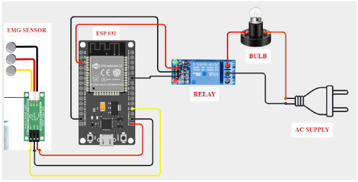

# EMG-Based Automation System
### Muscle Signal-Based Assistive Home Automation

<p align="center">
  <strong>Controlling Electrical Appliances Using Electromyography (EMG) Signals</strong>
</p>

<p align="center">
  
  
  
  
</p>

---

## 1. Introduction

The **EMG-Based Automation System** is an assistive technology project that uses muscle-generated electrical signals to control electrical appliances.

The system uses an Electromyography (EMG) sensor to detect electrical activity produced by human muscles. The detected signal is provided to a microcontroller, where it is processed using programmed logic and a threshold-based decision mechanism.

According to the detected muscle activity, the microcontroller controls a relay module to switch a connected electrical appliance ON or OFF.

The project explores an alternative method of human–machine interaction, particularly for assistive home automation and applications where conventional switches may be difficult to operate.

## 2. Problem Statement

Conventional electrical switches require physical interaction. This can create difficulties for individuals with limited mobility or physical disabilities.

This project explores a muscle-signal-based control approach in which muscle activity can be used as an input to operate electrical appliances.

## 3. Project Objectives

- Detect muscle electrical activity using an EMG sensor.
- Acquire EMG signals through a microcontroller.
- Process sensor readings using embedded programming.
- Implement threshold-based muscle activity detection.
- Control electrical appliances through a relay module.
- Explore assistive home automation applications.
- Develop a foundation for future wheelchair-based automation systems.

## 4. Key Features

- Muscle activity detection using an EMG sensor.
- Microcontroller-based signal acquisition.
- Threshold-based control mechanism.
- Relay-based electrical appliance switching.
- Embedded C/C++ programming.
- Expandable design for additional automation applications.

## 5. System Architecture

```text
       HUMAN MUSCLE ACTIVITY
                 |
                 v
          +-------------+
          |  EMG Sensor |
          +-------------+
                 |
                 v
          +-------------+
          | Signal Input|
          +-------------+
                 |
                 v
       +----------------------+
       |     Microcontroller  |
       |                      |
       |  Signal Acquisition  |
       |  Signal Processing   |
       |  Threshold Detection |
       |  Control Logic       |
       +----------------------+
                 |
                 v
          +-------------+
          | Relay Module|
          +-------------+
                 |
                 v
       +----------------------+
       | Electrical Appliance |
       |     (Example: Bulb)  |
       +----------------------+
```

## 6. Working Principle

The system operates through the following stages:

**Step 1 – Muscle Activity**

When a person contracts a muscle, electrical activity is generated within the muscle.

**Step 2 – Signal Detection**

The EMG sensor detects the electrical activity and produces an output signal.

**Step 3 – Signal Acquisition**

The microcontroller receives the EMG sensor output through its configured input pin.

**Step 4 – Signal Processing**

The programmed microcontroller reads and processes the sensor values.

**Step 5 – Threshold Detection**

The processed signal is compared with a predefined threshold value to identify the intended muscle activity.

**Step 6 – Relay Control**

Depending on the programmed conditions, the microcontroller activates or deactivates the relay module.

**Step 7 – Appliance Operation**

The relay controls the connected electrical appliance, demonstrating muscle-based automation.

## 7. Hardware Requirements

| Component | Purpose |
|---|---|
| EMG Sensor Module | Detects muscle electrical activity |
| Microcontroller Board | Processes EMG sensor readings |
| Relay Module | Controls electrical appliance switching |
| Electrical Bulb | Demonstrates output operation |
| Connecting Wires | Provides electrical connections |
| Power Supply | Powers the required electronic modules |
| EMG Electrodes | Collect muscle activity signals, if required by the sensor |

*Use the exact component models from your implemented hardware.*

## 8. Software Requirements

| Software / Technology | Purpose |
|---|---|
| Arduino IDE | Code development and uploading |
| Embedded C/C++ | Microcontroller programming |
| USB Driver | Communication with the development board, if required |
| Serial Monitor | Monitoring sensor readings and debugging |
| Board Support Package | Enables the selected microcontroller in Arduino IDE |

## 9. Repository Structure

```text
EMG-Based-Automation-System/
│
├── Arduino_Code/
│   └── emg_automation.ino
│
├── Circuit_Diagram/
│   └── emg_circuit_diagram.png
│
├── Hardware_Images/
│   ├── hardware_setup.jpg
│   ├── emg_sensor.jpg
│   ├── circuit_connection.jpg
│   ├── relax_mode.jpg
│   └── contraction_mode.jpg
│
├── README.md
│
└── LICENSE
```

The `LICENSE` file should only be added after selecting an appropriate license. The example filenames above should be replaced with your actual filenames.

## 10. Circuit Diagram

The circuit diagram represents the hardware connections between the EMG sensor, microcontroller, relay module, and output appliance.

<p align="center">
  
</p>

**Circuit connection details**

- EMG sensor output connects to the configured microcontroller input.
- Sensor and controller power connections must follow their respective specifications.
- Relay input connects to the configured microcontroller output.
- The relay switches the connected electrical load.

Refer to the uploaded circuit diagram for the actual pin connections.

## 11. Arduino Source Code

The complete microcontroller source code is available in:

`Arduino_Code/emg_automation.ino`

The program implements the sensor-reading and appliance-control logic.

### Main program operations

1. Initialize the required input and output pins.
2. Read the EMG sensor output.
3. Process the acquired readings.
4. Compare the readings with the configured threshold.
5. Apply the programmed control conditions.
6. Control the relay module.
7. Monitor readings through serial communication, if implemented.

### Configuration

Update the following values according to your actual Arduino code:

| Parameter | Project Value |
|---|---|
| Microcontroller | [Enter board model] |
| EMG sensor input pin | [Enter pin] |
| Relay output pin | [Enter pin] |
| Detection threshold | [Enter threshold] |
| Supply voltage | [Enter specification] |
| Relay operating logic | [Active HIGH / Active LOW] |

## 12. Installation and Setup

### Step 1 – Clone or Download the Repository

Download this repository from GitHub or clone it using Git.

### Step 2 – Install Arduino IDE

Download Arduino IDE from:

https://www.arduino.cc/en/software

### Step 3 – Install Board Support

Select and install the board package corresponding to your microcontroller.

### Step 4 – Connect the Hardware

Connect the EMG sensor, microcontroller, and relay module according to the circuit diagram.

### Step 5 – Open the Source Code

Open:

`Arduino_Code/emg_automation.ino`

### Step 6 – Configure the Board

Select the correct board model and communication port in Arduino IDE.

### Step 7 – Upload the Program

Compile and upload the code to the microcontroller.

### Step 8 – Test the System

Observe the sensor readings and verify the relay operation using a safe test load.

## 13. Hardware Implementation

The hardware implementation integrates the EMG sensor, microcontroller, relay module, and electrical output.

### Actual Hardware Setup


### EMG Sensor


### Circuit Connections


### Muscle Relaxation Condition


### Muscle Contraction Condition


*Replace these example image paths with the actual photographs in your repository.*

## 14. Testing and Results

The system can be evaluated by observing its response under different muscle activity conditions.

| Test Condition | Observation |
|---|---|
| Muscle relaxed | Record sensor output and relay state |
| Muscle contracted | Record sensor output and relay state |
| Signal near threshold | Observe the programmed decision |
| Repeated muscle activity | Check consistency of operation |
| Power restart | Verify initialization and safe output state |

**Measured results:** Add your actual sensor readings, threshold, relay response, and test observations here. Do not enter estimated values as experimental results.

## 15. Applications

- Assistive home automation.
- Muscle-signal-based appliance control.
- Alternative human–machine interfaces.
- Experimental wheelchair automation.
- Biomedical instrumentation education.
- Embedded systems research and development.

## 16. Advantages

- Uses muscle activity as a control input.
- Provides an alternative to conventional physical switches.
- Demonstrates integration of biomedical sensing and embedded systems.
- Uses a microcontroller-based control approach.
- Can be extended to additional appliances and control functions.

## 17. Limitations

- EMG readings may be affected by electrical noise and electrode placement.
- Muscle signals can differ between individuals.
- Threshold values may require calibration.
- Relay operation depends on correct hardware connections and control logic.
- The current implementation may support only the programmed number of outputs.

## 18. Future Scope

Possible future improvements include:

- Advanced EMG filtering and noise reduction.
- Automatic threshold calibration.
- Multiple muscle gesture recognition.
- Control of multiple home appliances.
- Wireless monitoring and control.
- Integration with smart-home platforms.
- Improved assistive wheelchair interfaces.
- More advanced signal classification using machine learning.

## 19. Safety Precautions

- Follow the EMG sensor manufacturer's instructions for electrode placement and operation.
- Do not connect electrodes to unsafe or unapproved electrical sources.
- Maintain appropriate isolation between the low-voltage control circuit and mains-powered appliances.
- Use a correctly rated relay and suitable protective enclosure.
- Never handle exposed mains wiring while powered.
- Begin testing with a safe low-voltage load.
- This prototype must not be treated as a certified medical or life-support device.

## 20. Project Team

| Name | Role |
|---|---|
| Aniket Kumar | Project Team Member |
| Md. Sahil | Project Team Member |
| Bhavishya Sharma | Project Team Member |
| Bhoopendra Singh | Project Team Member |

**Project Supervisor:**  
Mr. Kuldeep Godiyal  
Assistant Professor

**Institution:**  
Shivalik College of Engineering  
Dehradun, Uttarakhand, India

## 21. Contribution Guidelines

Contributions and suggestions are welcome.

You can contribute by:

- Improving EMG signal processing.
- Enhancing the control algorithm.
- Adding hardware documentation.
- Improving circuit design.
- Adding additional automation features.
- Reporting bugs and suggesting improvements.

## 22. License

A license has not yet been specified for this repository.

If you want others to reuse, modify, and distribute your project, select an appropriate open-source license and add its official license text.

## 23. Disclaimer

This project is developed for academic and experimental purposes. It demonstrates muscle-signal-based appliance control using embedded electronics.

It is not a certified medical device, a clinically validated assistive system, or a safety-certified wheelchair control system.

## 24. Contact and Project Information

**Project:** EMG-Based Automation System  
**Repository:** [GitHub Repository](https://github.com/sahilmd786/EMG-Based-Automation-System)  
**Domain:** Biomedical Electronics, Embedded Systems and Assistive Automation

---

<p align="center">
  <strong>EMG-Based Automation System</strong>
  <br/>
  Muscle Signals | Embedded Systems | Assistive Technology
</p>
